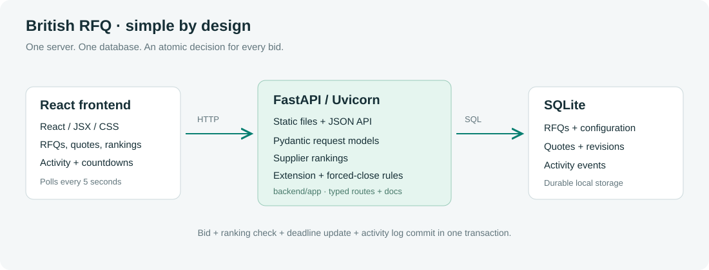
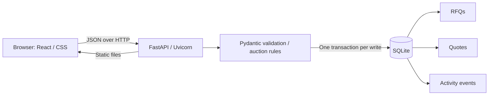

# High-level design

The buyer creates an RFQ and its auction rules. Suppliers submit quotes through the same demo workspace. A single Uvicorn process runs FastAPI, serving both the frontend and JSON API; SQLite stores RFQs, immutable quotes, and the activity log.

## Components

| Component | Responsibility |
| --- | --- |
| `frontend/src/` | RFQ list, search/filter, creation dialog, auction details, supplier quote form, countdowns and activity log |
| `backend/app/main.py` / FastAPI | Declares routes, serves the React build, translates domain errors, generates OpenAPI and `/docs` |
| `backend/app/models.py` / Pydantic | Validates field types, currency amounts, timezone-aware timestamps, and auction configuration |
| `backend/app/auction.py` / `Store` | Computes rankings/status, enforces bidding rules, accepts quotes and applies extensions atomically |
| SQLite | Persists RFQs, all submitted quotes, and creation/bid/extension events |

The frontend uses React with ordinary components, useState, useEffect, and a hash link for detail navigation. No router or state library is needed. Vite compiles JSX and bundles React into `frontend/dist/`; FastAPI serves that build through FileResponse and StaticFiles, and Uvicorn runs the application in one process. No ORM, queue, scheduler, cache, or WebSocket server is needed. SQL initialization runs safely on each startup. Five-second polling is sufficient for this simplified assignment.

## Source and deployment boundaries

`frontend/` is a Vite/React project with its own npm manifest and lockfile. Components, forms, HTTP access, and formatting have separate modules. `backend/` is a uv-managed Python project; `app` is a Python package using relative imports. Tests import that package directly, without changing Python's module search path.

Development uses Vite and Uvicorn as two processes with an `/api` proxy. The bundled deployment uses one Uvicorn process serving `frontend/dist/` and the API. For separate deployment, Vite builds with `VITE_API_BASE_URL`, while FastAPI runs with `--api-only` and permits explicit `FRONTEND_ORIGINS` using its standard CORS middleware. API-only mode has no dependency on frontend files. See [deployment commands](DEPLOYMENT.md). Source organization does not depend on whether deployment is combined or separate. The runtime database stays at the repository root, outside application source.

## Bid transaction

1. FastAPI validates the body using the Pydantic request model. The endpoint passes the typed model to `Store`; money is converted from Decimal to integer minor units.
2. Acquire a SQLite write reservation with `BEGIN IMMEDIATE` before reading the authoritative server time, RFQ deadline, and current quotes.
3. Reject bidding before start or at/after current/forced close. Check validity, supplier revision, and duplicate total rules.
4. Insert the quote and bid event. Compare rankings before and after the insertion.
5. Evaluate `British enabled AND beats previous lowest AND inside current window AND any enabled trigger matches`.
6. When eligible, compute `min(current_close + Y, forced_close)`. Update close and append an extension event with old/new deadlines, matching triggers, and cap information only if time was actually added.
7. Commit the quote, new deadline, and events together. Roll back everything on failure.

This serializes competing writers: a later bid sees an earlier committed bid and its new close time. The clock is sampled after obtaining the lock so a waiting bid cannot use a stale pre-deadline timestamp. A 10-second busy timeout bounds database waits. Read requests use one snapshot for consistent rankings, deadlines, and events. WAL mode allows readers during writes.

## Auction lifecycle

Status is derived from the server time and current deadline on every read. There is no worker to “close” an auction: every bid rechecks the deadline, so bidding stops correctly even if no browser is open. Original close is immutable; only current close can change. Forced close is an immutable upper bound enforced in code and a database CHECK constraint.

A closed auction whose current deadline is before forced close remains Closed forever. Force Closed identifies auctions that actually reached the forced deadline. Scheduled is an additional useful state for RFQs with future start times.

## HTTP API

| Method / route | Request | Result |
| --- | --- | --- |
| `GET /api/rfqs` | None | RFQ summaries and server time |
| `POST /api/rfqs` | RFQ and configuration fields | `201 {id}` |
| `GET /api/rfqs/{id}` | None | RFQ, latest supplier rankings, complete price-sorted quote history, newest-first activity, server time |
| `POST /api/rfqs/{id}/quotes` | Carrier, three charges, transit days, validity | `201 {quote_id, extended}` |

JSON field names are shown in the browser's requests and in the HTTP tests. Money inputs (`freight`, `origin`, `destination`) may be decimal strings; responses use integer `*_cents` fields. Dates/times are ISO 8601 with timezone offsets; service date is `YYYY-MM-DD`. Trigger keys are `bid_received`, `rank_change`, and `l1_change`.

Errors use `{ "error": "message" }`: 422 for FastAPI/Pydantic request validation, 400 for domain input rules, 404 for missing records/routes, 405 for unsupported methods, 409 for bidding/uniqueness conflicts, and 503 for database unavailability. Exception handlers preserve the error envelope expected by React. FastAPI handles body parsing and field validation; there is no custom HTTP parser or application body-size middleware. Timestamps and prices supplied by clients never control auction time or the derived quote total.

Interactive API documentation is at `/docs`; `/openapi.json` includes the RFQCreate and QuoteCreate request schemas. Endpoints are normal synchronous functions, so FastAPI runs SQLite operations in its thread pool. The application lifespan initializes the database and optional demo data at startup, without database writes during module import.

## Scope and tradeoffs

- This is a local, trusted demonstration. The entered carrier name is identity; there is no authentication, buyer/supplier authorization, tenant separation, or protection against someone impersonating a carrier. The listener binds to `127.0.0.1` by default.
- SQLite gives simple, durable transactions with one writer. A larger deployment could move the same critical section to PostgreSQL with a row lock per RFQ. This implementation does not claim distributed scale.
- Polling can show up to five seconds of stale status, while bid validation always uses current server state. Network errors are surfaced and subsequent polls retry.
- Rankings and quote history are computed on demand, with no pagination. This suits an assignment's small dataset; large bid volumes would need paging and query optimization.
- RFQ editing, deleting, cancellation, early close, supplier invitations, quote withdrawal, awards, notifications, and currency conversion are not required and are omitted.
- An additional extension condition applies: only new auction-wide best prices qualify. Consequently the three original triggers often overlap; they remain individually selectable to satisfy the assignment, with meaningful differences when the current leader improves its own bid.

## Success metrics

The UI displays quotes, participating suppliers, and extension count for each RFQ. All accepted quotes and deadline changes are retained, so bids per RFQ and initial-to-final price reduction can be calculated from history. Comparing extended versus non-extended auctions requires comparable real auction data; this demo does not claim a measured pricing improvement.

## Framework references

[React createRoot](https://react.dev/reference/react-dom/client/createRoot) · [Vite build guide](https://vite.dev/guide/build.html)

[FastAPI request models](https://fastapi.tiangolo.com/tutorial/body/) · [FastAPI testing](https://fastapi.tiangolo.com/tutorial/testing/) · [FastAPI static files](https://fastapi.tiangolo.com/tutorial/static-files/)
